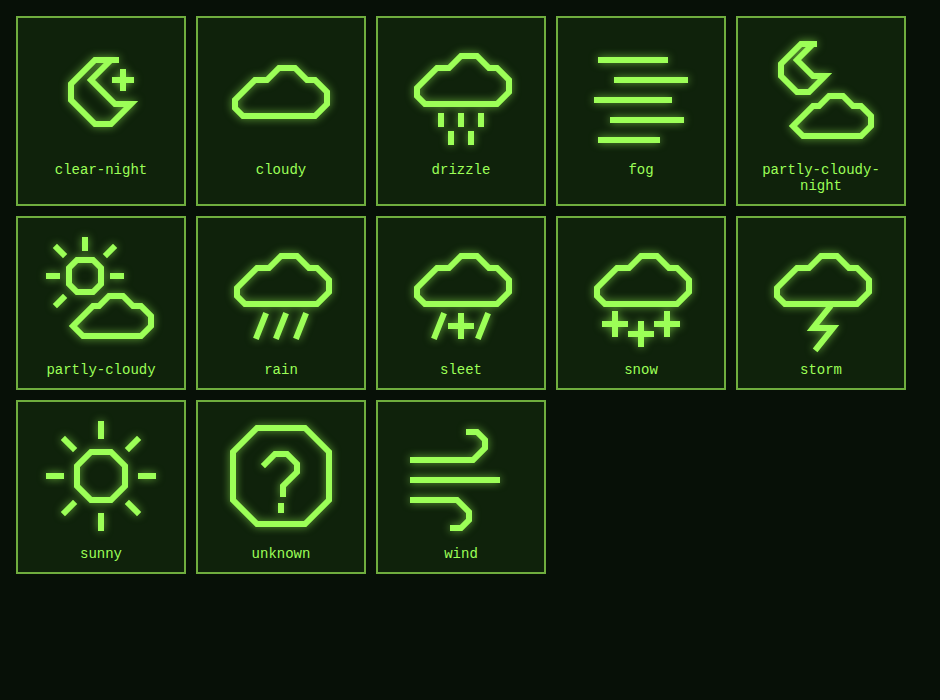

# Outpost

A self-hosted dashboard platform for weather, alerts, sensors, power monitoring, and telemetry, with themeable HUD-style displays.

> **Status:** early development (pre-1.0). The dashboard and container work with a built-in mock source and live Open-Meteo and National Weather Service data. More providers are in progress. Expect breaking changes until 1.0.

<!-- TODO (public beta): add a hero screenshot here, e.g.

-->

## Features

- Single-container deployment: one Docker image, one port, one data volume
- Live conditions, 5-day forecast, and alerts on a retro terminal-style HUD
- Normalized weather data format, so the display doesn't care which provider supplied it
- Built-in health check (including stale-data detection)
- Warning banner when data is old, degraded, or unavailable

## Quick start

Requires Docker and Docker Compose.

```bash
git clone <your-repo-url> outpost
cd outpost
cp .env.example .env      # then edit .env (location, units, provider)
docker compose up -d --build
```

Open `http://localhost:8088`.

To view logs: `docker logs -f outpost`
To stop: `docker compose down`

## Configuration

All settings are environment variables, set in `.env` (Compose) or in your container template.

| Variable | Default | Description |
|---|---|---|
| `OUTPOST_PROVIDER` | `mock` | Weather data source. See [Weather providers](#weather-providers). |
| `OUTPOST_THEME` | `retro-crt` | Dashboard look. See [Themes](#themes). |
| `OUTPOST_AUTO_DIM` | `true` | Dim the display at night. See [Day/night dimming](#daynight-dimming). |
| `OUTPOST_DIM_LEVEL` | `0.35` | Night brightness, from `0.05` (very dark) to `1` (no dimming). |
| `OUTPOST_DIM_MODE` | `sun` | `sun` follows sunset and sunrise; `schedule` uses fixed times. |
| `OUTPOST_DIM_START` / `OUTPOST_DIM_END` | `22:00` / `06:00` | Night window for `schedule` mode (24-hour `HH:MM`). |
| `OUTPOST_LOCATION_NAME` | `Goodsprings, NV` | Name shown at the top of the dashboard. |
| `OUTPOST_LATITUDE` | `35.8319` | Latitude in decimal degrees. |
| `OUTPOST_LONGITUDE` | `-115.4328` | Longitude in decimal degrees. |
| `OUTPOST_UNITS` | `imperial` | Unit system. |
| `OUTPOST_UPDATE_INTERVAL` | `60` | Seconds between data updates. |
| `OUTPOST_USER_AGENT` | `Outpost/<version>` | Identifies your instance to weather services. |
| `OUTPOST_WEB_PORT` | `8088` | Host port for the web UI (Compose only). |

The defaults point at Goodsprings, NV. Set your own latitude and longitude to see your local weather.

## Weather providers

| Provider | `OUTPOST_PROVIDER` | API key | Status |
|---|---|---|---|
| Mock (test data) | `mock` | No | Available |
| [Open-Meteo](https://open-meteo.com) | `openmeteo` | No | Available (recommended default) |
| [National Weather Service](https://www.weather.gov/documentation/services-web-api) | `nws` | No | Available (US only, includes alerts) |
| Auto | `auto` | No | Available (NWS in the US, Open-Meteo elsewhere) |
| [MET Norway](https://api.met.no) | `metno` | No | Planned |
| [Pirate Weather](https://pirateweather.net) | `pirateweather` | Yes | Planned |
| [OpenWeatherMap](https://openweathermap.org) | `openweathermap` | Yes | Planned |

The National Weather Service asks every client to identify itself, so set `OUTPOST_USER_AGENT` with a contact email or URL. NWS does not publish a UV index, so with `nws` alone that field shows `--`. With `auto`, anything NWS leaves empty (UV index, and any reading a station is missing) is filled in from Open-Meteo, and the footer credits both sources. Open-Meteo is free for non-commercial use and requires attribution, which the dashboard footer provides. Each provider has its own terms of use, attribution requirements, and rate limits. Please review them before running Outpost publicly or commercially.

## Data and storage

The updater writes normalized weather data to `/data/weather.json` inside the container, and the web server serves it to the dashboard. Mount `/data` as a volume (Compose does this with `./data`) so data survives restarts.

You can read the same file from other tools:

```bash
curl http://localhost:8088/data/weather.json
```

See [docs/data-format.md](docs/data-format.md) for the field reference. <!-- TODO: write this once the schema settles -->

## Running on unRAID

A Community Apps template is planned. Until then, you can add the container manually once an image is published:

- **Port:** container `80` to a host port of your choice
- **Path:** container `/data` to `/mnt/user/appdata/outpost`
- **Variables:** each `OUTPOST_*` setting from the table above

## Project layout

```
app/        Updater, health check, and provider modules (Python)
web/        Dashboard front end (HTML, CSS, JS)
assets/     Icons and fonts
data/       Generated weather.json (runtime, not committed)
```

## Themes

Four themes are included: `retro-crt` (default), `amber-terminal`, `command-center`, and `modern-dark`. Set `OUTPOST_THEME` to switch, or add `?theme=name` to the address to preview one. Themes are small CSS files, so making your own is easy; see [docs/themes.md](docs/themes.md).

<!-- TODO (public beta): add a screenshot of each theme here -->

## Day/night dimming

Outpost can dim itself at night so a wall-mounted display isn't glaring in a dark room. It is on by default.

- **`sun` mode (default):** brightness follows the sun's position at your latitude and longitude. The display fades down over about 30 minutes after sunset and back up around sunrise. No internet connection or weather service is needed for this.
- **`schedule` mode:** dims between `OUTPOST_DIM_START` and `OUTPOST_DIM_END` with a 30-minute fade. Times use the clock of the device showing the dashboard, so make sure its time zone is correct.
- **Preview:** add `?dim=night`, `?dim=day`, or `?dim=0.5` to the address to try a brightness without waiting for dark.

Dimming is done in the browser, so it doesn't change your display's backlight. It also helps reduce burn-in on OLED screens.

## Icons

Outpost ships an original, monochrome icon set (13 icons covering clear, cloudy, fog, drizzle, rain, sleet, snow, storm, wind, day and night variants, and an "unknown" fallback). Icons are plain SVGs in `assets/icons/` and are tinted with CSS, so themes can recolor them.



To add or change an icon, draw it on a 64x64 grid with a 3px stroke, square caps, and `currentColor`, then add its name to the `ICONS` list in `web/app.js`.

## Roadmap

See [ROADMAP.md](ROADMAP.md) for where Outpost is going, and the [milestones](../../milestones) for the work in progress. Ideas are welcome as issues.

## Contributing

Issues and pull requests are welcome once the project reaches public beta. See `CONTRIBUTING.md` (planned).

## Changelog

See [CHANGELOG.md](CHANGELOG.md).

## License

Outpost is released under the [MIT License](LICENSE).

Weather data remains subject to each provider's own terms, and any third-party fonts or icons you add keep their own licenses.
