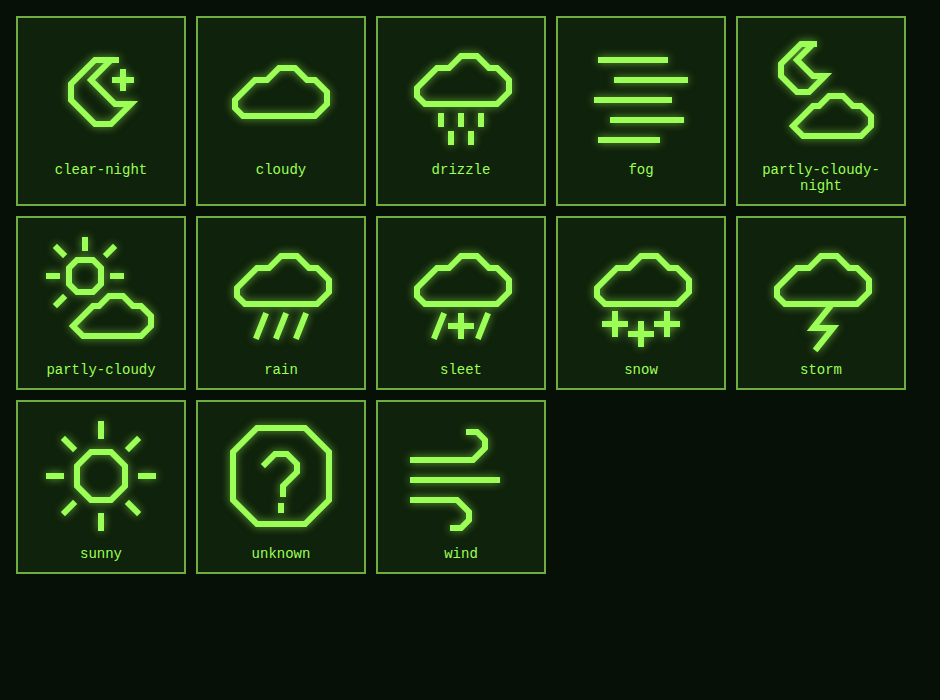

<p align="center"></p>

# Outpost

[](https://github.com/maxtrax04/outpost/actions/workflows/ci.yml)

A self-hosted dashboard platform for weather, alerts, sensors, power monitoring, and telemetry, with themeable HUD-style displays.

> **Status:** early development (pre-1.0). The dashboard and container work with a built-in mock source and live Open-Meteo, National Weather Service, MET Norway, and Pirate Weather data. More providers are in progress. Expect breaking changes until 1.0.

<!-- TODO (public beta): add a hero screenshot here, e.g.

-->

## Features

- Single-container deployment: one Docker image, one port, one data volume
- Live conditions, 5-day forecast, and alerts on a retro terminal-style HUD
- Normalized weather data format, so the display doesn't care which provider supplied it
- Built-in health check (including stale-data detection)
- Warning banner when data is old, degraded, or unavailable
- Themes: seven built in (from green-phosphor terminals to a 1950s television and black-on-white for ePaper), more from the [community](https://github.com/maxtrax04/outpost-themes), or your own, with no rebuild

## Quick start

Requires Docker and Docker Compose.

```bash
git clone https://github.com/maxtrax04/outpost.git
cd outpost
cp .env.example .env      # then edit .env (location, units, provider)
docker compose up -d --build
```

Open `http://localhost:8088`.

To view logs: `docker logs -f outpost`
To stop: `docker compose down`

## Run the published image

To skip building, replace the `build:` section of your compose file with the image:

```yaml
services:
  outpost:
    image: ghcr.io/maxtrax04/outpost:latest
    container_name: outpost
    ports:
      - "8088:80"
    env_file:
      - .env
    volumes:
      - ./data:/data
    restart: unless-stopped
```

Or with plain Docker:

```
docker run -d --name outpost -p 8088:80 --env-file .env -v ./data:/data ghcr.io/maxtrax04/outpost:latest
```

Images are built for amd64 (PCs, unRAID) and arm64 (Raspberry Pi). Use a version tag such as `0.4.0` to stay on a specific release, or `edge` to try the latest changes from `main`.

## Configuration

All settings are environment variables, set in `.env` (Compose) or in your container template.

| Variable | Default | Description |
|---|---|---|
| `OUTPOST_PROVIDER` | `mock` | Weather data source. See [Weather providers](#weather-providers). |
| `OUTPOST_PIRATEWEATHER_API_KEY` | *(empty)* | Your free [Pirate Weather](https://pirateweather.net) API key, for `pirateweather`, or for `auto` to use Pirate Weather outside the Nordic countries and the US (and as a fallback there). Keep it private; it is only sent to Pirate Weather. |
| `OUTPOST_ALERTS_PROVIDER` | `auto` | Where official alerts come from: `auto` (the weather provider's own; else NWS in the US; else MET Norway in Norway; else Pirate Weather when you have a key), `nws`, `metno`, `pirateweather`, or `none`. See [Alerts](#alerts). |
| `OUTPOST_THEME` | `retro-crt` | Dashboard look. See [Themes](#themes). |
| `OUTPOST_THEME_SWITCHER` | `true` | Show the on-screen theme switcher button. Set `false` for a kiosk display. |
| `OUTPOST_COMMUNITY_THEMES` | (empty) | Community themes to download when the container starts, as `username/theme` separated by commas. See [Community themes](#community-themes). |
| `OUTPOST_COMMUNITY_THEMES_REF` | `main` | Which version of the community themes to download: a branch, tag, or commit. |
| `OUTPOST_EFFECTS` | `full` | `reduced` turns off scanlines, glow, and animation for everyone. See [Reduced effects](#reduced-effects). |
| `OUTPOST_EFFECTS_TOGGLE` | `true` | Show the "Reduced effects" checkbox in the theme panel. Set `false` so viewers cannot change `OUTPOST_EFFECTS`. |
| `OUTPOST_AUTO_DIM` | `true` | Dim the display at night. See [Day/night dimming](#daynight-dimming). |
| `OUTPOST_DIM_LEVEL` | `0.35` | Night brightness, from `0.05` (very dark) to `1` (no dimming). |
| `OUTPOST_DIM_MODE` | `sun` | `sun` follows sunset and sunrise; `schedule` uses fixed times. |
| `OUTPOST_DIM_START` / `OUTPOST_DIM_END` | `22:00` / `06:00` | Night window for `schedule` mode (24-hour `HH:MM`). |
| `OUTPOST_CLOCK` | `auto` | `12` shows times like 1:05 PM, `24` like 13:05, on every theme. `auto` follows the viewing browser's language, not the device's 12/24-hour clock setting (browsers do not share it), so a browser in US English shows 12-hour times. Each screen can also choose with the "24-hour clock" checkbox in the theme panel (saved in that browser), or `?clock=12` / `?clock=24` in the address. |
| `OUTPOST_CLOCK_TOGGLE` | `true` | Show the "24-hour clock" checkbox in the theme panel. Set `false` so viewers cannot change `OUTPOST_CLOCK`. |
| `OUTPOST_SUBTITLE` | *(empty)* | Optional line under the title. Empty hides it; `{date}` and `{time}` show the current date and time. |
| `OUTPOST_ALERTS_ALWAYS_SHOW` | `false` | `false` hides the Alerts panel when there are none; `true` always shows it. See [Alerts](#alerts). |
| `OUTPOST_MOCK_ALERTS` | `false` | With the `mock` provider, `true` always includes sample alerts (one of each severity), for trying how alerts look. See [Alerts](#alerts). |
| `OUTPOST_LOCATION_NAME` | `Goodsprings, NV` | Name shown at the top of the dashboard. |
| `OUTPOST_LATITUDE` | `35.8319` | Latitude in decimal degrees. |
| `OUTPOST_LONGITUDE` | `-115.4328` | Longitude in decimal degrees. |
| `OUTPOST_UNITS` | `imperial` | `imperial` (°F, mph, inHg, miles) or `metric` (°C, km/h, hPa, km), for the dashboard and `weather.json`. |
| `OUTPOST_UPDATE_INTERVAL` | `60` | Seconds between data updates (at least 60). Each weather service is still asked no more often than it allows; see [Request limits](#request-limits). |
| `OUTPOST_CONTACT` | *(empty)* | Your email address or website, so weather services can reach you. Recommended for `nws`, `metno`, and `auto` (and NWS alerts). It is sent in the User-Agent header, after the project page that Outpost always includes. |
| `OUTPOST_USER_AGENT` | *(empty)* | Advanced: replaces the whole User-Agent (normally `Outpost/<version> (<contact>; +https://github.com/maxtrax04/outpost)`). |
| `OUTPOST_FRAME_ANCESTORS` | *(empty)* | Comma-separated list of sites allowed to show Outpost in a frame, such as `http://homeassistant.local:8123` for a Home Assistant webpage card. Empty allows only Outpost itself. See [SECURITY.md](SECURITY.md#security-headers). |
| `OUTPOST_WEB_PORT` | `8088` | Host port for the web UI (Compose only). |

The defaults point at Goodsprings, NV. Set your own latitude and longitude to see your local weather.

## Weather providers

| Provider | `OUTPOST_PROVIDER` | API key | Status |
|---|---|---|---|
| Mock (test data) | `mock` | No | Available |
| [Open-Meteo](https://open-meteo.com) | `openmeteo` | No | Available (recommended default) |
| [National Weather Service](https://www.weather.gov/documentation/services-web-api) | `nws` | No | Available (US only, includes alerts) |
| Auto | `auto` | No | Available (MET Norway in the Nordic countries, NWS in the US, elsewhere Pirate Weather if you have a key, otherwise Open-Meteo) |
| [MET Norway](https://api.met.no) | `metno` | No | Available (worldwide, best in the Nordic countries) |
| [Pirate Weather](https://pirateweather.net) | `pirateweather` | Yes (free) | Available (worldwide) |
| [OpenWeatherMap](https://openweathermap.org) | `openweathermap` | Yes | Planned |

### How `auto` chooses

| Your location | Weather from | Filled in from | Alerts (with `OUTPOST_ALERTS_PROVIDER=auto`) |
|---|---|---|---|
| Norway, Sweden, Finland, Denmark, Iceland, the Faroe Islands, Svalbard, Jan Mayen | MET Norway (if it fails: Pirate Weather with a key, then Open-Meteo once the data is stale) | Open-Meteo (visibility, later UV) | MET Norway in Norway; elsewhere Pirate Weather with a key, else none (NWS is not asked) |
| The United States and its territories | National Weather Service (if it fails: Pirate Weather with a key, then Open-Meteo once the data is stale) | Open-Meteo (UV, missing station readings) | National Weather Service |
| Everywhere else, with `OUTPOST_PIRATEWEATHER_API_KEY` set | Pirate Weather (Open-Meteo if it fails) | Open-Meteo, for anything missing | Pirate Weather |
| Everywhere else, without a key | Open-Meteo | (nothing missing) | None |

The Nordic check is done from your coordinates alone; the US check is the National Weather Service answering that it covers them. To always use one provider, set `OUTPOST_PROVIDER` to it.

The National Weather Service asks every client to identify itself, so set `OUTPOST_CONTACT` to an email address or website (Outpost warns at startup if it is missing). NWS does not publish a UV index, so with `nws` alone that field shows `--`. With `auto`, Outpost uses MET Norway in Norway, Sweden, Finland, Denmark, Iceland, the Faroe Islands, Svalbard, and Jan Mayen, where its forecast is at its best; the National Weather Service in the US; and everywhere else Pirate Weather if `OUTPOST_PIRATEWEATHER_API_KEY` is set, otherwise Open-Meteo. When MET Norway or NWS fails, Pirate Weather takes over at once if you have a key. Otherwise the last good data stays on screen (marked degraded) during a short outage, and once it is stale (three missed updates, at least 5 minutes) Open-Meteo takes over until MET Norway or NWS answers again. The Nordic check uses rough areas around those countries, worked out from your coordinates without asking any service, so near a border set `OUTPOST_PROVIDER` yourself if it picks the wrong one. Anything MET Norway or NWS leaves empty (such as visibility from MET Norway, or UV index and any reading a station is missing from NWS) is filled in from Open-Meteo, and the footer credits both sources. MET Norway requires every request to say what is asking (Outpost always sends its project page) and asks for a contact, so set `OUTPOST_CONTACT`; it also requires credit, which the footer gives; its data is shared under CC BY 4.0. Outpost downloads its forecast only when it has changed (MET Norway says when, about every 30 minutes), whatever `OUTPOST_UPDATE_INTERVAL` is. MET Norway sends a forecast rather than station readings, so "now" is the forecast for this hour, visibility shows `--`, and UV index is for a clear sky. Forecast days follow the container's `TZ` setting, so set it to your time zone. Pirate Weather needs a free API key from [pirateweather.net](https://pirateweather.net): sign up, subscribe the key to the forecast API, and set `OUTPOST_PIRATEWEATHER_API_KEY`. The free tier allows 10,000 calls a month, so Outpost asks at most every 10 minutes (about 4,300 a month) whatever `OUTPOST_UPDATE_INTERVAL` is, and if the quota still runs out it waits for the reset instead of asking again. Its alerts come with the forecast; see [Alerts](#alerts). Open-Meteo is free for non-commercial use and requires attribution, which the dashboard footer provides. Each provider has its own terms of use, attribution requirements, and rate limits. Please review them before running Outpost publicly or commercially.

### Request limits

However short you set `OUTPOST_UPDATE_INTERVAL`, Outpost asks each weather service no more often than this. Between requests, it reuses the service's last answer. The updater lists these limits in its log when it starts.

| Service | Asked at most | Why |
|---|---|---|
| Open-Meteo | Every 15 minutes | Its current conditions change every 15 minutes, and the free tier allows fewer than 10,000 calls a day |
| National Weather Service | Forecast every 15 minutes, station readings every 5, alerts every minute | NWS asks clients to cache; forecasts change about hourly, alerts at any time |
| MET Norway (weather and warnings) | When MET Norway says the data may have changed (about every 30 minutes for the forecast) | Its terms require following the `Expires` header |
| Pirate Weather | Every 10 minutes | The free tier allows 10,000 calls a month |

`OUTPOST_UPDATE_INTERVAL` itself is at least 60 seconds; a shorter value is raised to 60, with a warning in the log. A shorter interval than these limits is still useful: alerts and fallbacks are checked on every update.

## Data and storage

The updater writes normalized weather data to `/data/weather.json` inside the container, and the web server serves it to the dashboard. Mount `/data` as a volume (Compose does this with `./data`) so data survives restarts.

You can read the same file from other tools:

```bash
curl http://localhost:8088/data/weather.json
```

Every field is described in [docs/data-format.md](docs/data-format.md), with a [JSON Schema](docs/schema/weather-v1.json). The file has a `schema_version`, which goes up only when a change would break a tool that reads it.

## Running on unRAID

A Community Apps template is planned. Until then, you can add the container manually once an image is published:

- **Port:** container `80` to a host port of your choice
- **Path:** container `/data` to `/mnt/user/appdata/outpost`
- **Path (optional, your own themes):** container `/config/themes` to `/mnt/user/appdata/outpost/themes`, access mode Read Only. Put each theme in its own folder there, for example `/mnt/user/appdata/outpost/themes/sonar/theme.css`, then restart the container. See [docs/themes.md](docs/themes.md#adding-themes-without-rebuilding).
- **Variables:** each `OUTPOST_*` setting from the table above

## Project layout

```
app/        Updater, health check, and provider modules (Python)
web/        Dashboard front end (HTML, CSS, JS)
assets/     Weather icons, app (home-screen) icons, the logo, and fonts
tests/      Automated tests and sample data
data/       Generated weather.json and config.json (runtime, not committed)
```

## Themes

Seven themes are included: `retro-crt` (default), `amber-terminal`, `command-center`, `modern-dark`, `field-station` (a steel instrument panel with dials), `atomic-broadcast` (a 1950s television set), and `ink` (black on white, for ePaper; see [ePaper displays](#epaper-displays)). Set `OUTPOST_THEME` to choose the default for everyone, or add `?theme=name` to the address to preview one. More themes are in the [community themes](#community-themes) repository.

Anyone viewing the dashboard can also pick a theme with the small button in the bottom-left corner (it is faint until you hover or tap it). The choice is remembered in that browser only, with a "Use server default" option to undo it. Set `OUTPOST_THEME_SWITCHER=false` to remove the button, for example on a wall display.

Themes are small CSS files, so making your own is easy. Mount a folder of your own themes at `/config/themes` to add them without rebuilding the image; [examples/themes/](examples/themes/) has one to start from. See [docs/themes.md](docs/themes.md).

<!-- TODO (public beta): add a screenshot of each theme here -->

### Community themes

More themes, made by Outpost users, are in the [outpost-themes](https://github.com/maxtrax04/outpost-themes) repository. Each is named after the person who made it, such as `maxtrax04/weather-desk`, and shows in the theme switcher by its name alone (with the username added only if two themes share a name).

List the ones you want, and Outpost downloads them when the container starts:

```
OUTPOST_COMMUNITY_THEMES=maxtrax04/weather-desk,maxtrax04/wristcomp
```

- They are downloaded once per start, not again while it runs, so restart the container to get updates. They are kept in your data volume, so after the first download they keep working with no internet. If a download fails, Outpost uses the copies it has, logs one warning, and carries on; nothing waits for it.
- Themes you take off the list are removed at the next start. A theme that builds on another theme by the same person (such as `maxtrax04/weather-desk-live` on `maxtrax04/weather-desk`) brings it along automatically.
- Use one with `OUTPOST_THEME=maxtrax04/weather-desk` or `?theme=maxtrax04/weather-desk`, like any other theme.
- `OUTPOST_COMMUNITY_THEMES_REF` picks a version of the repository (a branch, tag, or commit) instead of the latest.
- Themes are only CSS, fonts, and images, and Outpost's security headers stop them from running scripts or loading anything from other sites.

To use community themes with no internet at all, clone the repository and mount it as your custom themes folder instead: `- ./outpost-themes:/config/themes:ro`. Themes in it keep the same names. Your own themes can sit beside them.

### Reduced effects

Scanlines, glow, and animation can be turned off in every theme, which helps readability and slow wall tablets:

- **For everyone:** set `OUTPOST_EFFECTS=reduced`.
- **Automatically:** a device set to reduce motion (in its accessibility settings) gets reduced effects.
- **Per browser:** the "Reduced effects" checkbox in the theme panel turns them off or back on in that browser, and wins over the two above. "Use server default" forgets it. Set `OUTPOST_EFFECTS_TOGGLE=false` to remove the checkbox, so everyone gets `OUTPOST_EFFECTS`. The checkbox is in the theme panel, so `OUTPOST_THEME_SWITCHER=false` removes it too.
- **To preview:** add `?effects=reduced` (or `?effects=full`) to the address.

## Alerts

The Alerts panel lists active weather warnings. `OUTPOST_ALERTS_PROVIDER` picks where they come from:

- **`auto` (default):** from the weather provider, if it has alerts (`nws`, and `auto` inside the US). If it has none, as with Open-Meteo, Outpost asks the National Weather Service, which covers the US (including Alaska, Hawaii, and the territories). In Norway (including Svalbard and Jan Mayen), they come from MET Norway, which issues Norway's official warnings. Outside the US, if you have set `OUTPOST_PIRATEWEATHER_API_KEY`, alerts come from Pirate Weather. Otherwise the dashboard says alerts are not available rather than claiming there are none. This sends your coordinates to the National Weather Service as well, even outside the US (where it answers that it has no data, which Outpost then remembers for about 30 minutes), except in the Nordic countries, which Outpost recognizes by itself. Use `none` if you don't want that. Set `OUTPOST_CONTACT` too, since NWS asks for it.
- **`nws`:** always from the National Weather Service, whatever the weather provider. Outside the US there are none, and the log says so once.
- **`metno`:** always MET Norway's warnings (MetAlerts), the official ones for Norway, for land (not the gale warnings for sea areas). Outpost works out from your coordinates whether you are in Norway, since MET Norway has no warnings elsewhere; outside Norway there are none, and the log says so once.
- **`pirateweather`:** always from Pirate Weather (needs `OUTPOST_PIRATEWEATHER_API_KEY`). Pirate Weather passes on the official warnings that national weather services publish to the WMO's global alert hub (in Europe through MeteoAlarm), plus the National Weather Service's for the lower 48 US states. Which countries take part changes over time, and an empty list looks the same whether there are no alerts or your country isn't covered, so the dashboard then says "none reported by Pirate Weather" rather than "none". Alerts are in the language the weather service published them in. If you also get the weather from Pirate Weather, the alerts come in the same request and use none of your quota.
- **`none`:** no alerts.

If the alerts lookup fails while the weather comes through, the dashboard keeps the last alerts it had and shows the degraded warning, so a failed check never looks like "no alerts". The footer names the alerts source when it differs from the weather source.

By default the panel is hidden when there is nothing to show, and a one-line note below the forecast says when alerts were last checked, for example `Alerts: none (checked 2:15 PM)`. Set `OUTPOST_ALERTS_ALWAYS_SHOW=true` to keep the panel visible. Severe and extreme alerts turn the panel red.

To see how alerts look without waiting for real weather, use `OUTPOST_PROVIDER=mock` with `OUTPOST_MOCK_ALERTS=true`: the dashboard then always shows three sample alerts, one each of severe, moderate, and minor.

The dashboard also shows today's sunrise and sunset (or "Midnight sun" / "Polar night" near the poles), calculated in the browser from your coordinates (no weather service needed). Times on the dashboard (sunrise and sunset, "Updated", and when alerts end) are shown as they are at the weather location, in the time zone the weather service reports (or the container's `TZ` setting for MET Norway). When the screen is in a different time zone, the zone is added, as in `4:12 PM GMT+1`, so it is clear whose time it is.

## Phones, tablets, and tall screens

The dashboard adapts to the screen: phones get a compact layout with the forecast as one row per day, tablets and wide screens keep five forecast cards in a row, phones turned sideways use a short header, and tall portrait screens (a monitor or tablet mounted upright) scale everything up and center it vertically. Notches and rounded corners are respected.

**Add it to your home screen** to open it like an app, without browser bars:

- **iPhone or iPad (Safari):** tap Share, then Add to Home Screen.
- **Android (Chrome):** open the menu, then Add to Home screen (or Install app).

Outpost provides the icon and settings for this. Note that browsers only offer a full "Install app" prompt over HTTPS; on a plain `http://` address on your home network, Add to Home Screen still works but creates a shortcut. The icon is a placeholder until Outpost gets its own logo.

### ePaper displays

ePaper screens use very little power, which suits a dashboard on the wall. Open the `ink` theme on that screen only by adding `?theme=ink` to its address (for example `http://outpost.local:8088/?theme=ink`), so your other screens keep their own theme.

- `ink` is pure black on white, so it suits black-and-white panels. Severe alerts are dark red, which a color panel shows in red and a black-and-white panel shows in black. Alert levels are also spelled out and shown by their borders, so they don't depend on color.
- It has no scanlines, glow, or animation, and no night dimming, since paper has no light to dim.
- It fits the whole dashboard on the screen without scrolling, down to 800 × 480 panels. On short screens each alert gets one line (its title and end time).
- Every change on the screen makes an ePaper panel redraw, which on many panels is a visible flash. To avoid extra redraws, don't put `{time}` in `OUTPOST_SUBTITLE` (it changes every minute). You can also set `OUTPOST_THEME_SWITCHER=false` if nobody will change the theme from that screen.
- Color ePaper also works with the other themes and [reduced effects](#reduced-effects), but their dark backgrounds and dim colors look muddy on most panels.

This needs a web browser on the device, such as an ePaper tablet. Panels that only download a picture to show (many microcontroller and e-reader setups) aren't supported.

## Day/night dimming

Outpost can dim itself at night so a wall-mounted display isn't glaring in a dark room. It is on by default.

- **`sun` mode (default):** brightness follows the sun's position at your latitude and longitude. The display fades down over about 30 minutes after sunset and back up around sunrise. No internet connection or weather service is needed for this.
- **`schedule` mode:** dims between `OUTPOST_DIM_START` and `OUTPOST_DIM_END` with a 30-minute fade. Times use the clock of the device showing the dashboard, so make sure its time zone is correct.
- **Preview:** add `?dim=night`, `?dim=day`, or `?dim=0.5` to the address to try a brightness without waiting for dark.

Dimming is done in the browser, so it doesn't change your display's backlight. It also helps reduce burn-in on OLED screens.

## Icons

Outpost ships an original, monochrome icon set (13 icons covering clear, cloudy, fog, drizzle, rain, sleet, snow, storm, wind, day and night variants, and an "unknown" fallback). Icons are plain SVGs in `assets/icons/` and are tinted with CSS, so themes can recolor them.



To add or change an icon, draw it on a 64x64 grid with a 3px stroke, square caps, and `currentColor`, then add its name to the `ICONS` list in `web/app.js`.

### Logo

The Outpost logo is an original stencil plate design in `assets/logo/`: `mark.svg` (the square "OP" plate), `wordmark.svg` (the plate reading OUTPOST, shown in the dashboard header), and `lockup.svg` (both together). Like the icons, they are one-color SVGs tinted with CSS, so each theme shows them in its own colors. A theme can show the plain text title instead (see `--title-logo` in [docs/themes.md](docs/themes.md#tokens)).

The favicon and home-screen icons in `assets/app/` are made from `mark.svg`. After changing the mark, rebuild them with `scripts/build-app-icons.js` (the command is at the top of the file); a test fails if the favicon no longer matches the mark.

## Development

Tests run automatically on every pull request (see `.github/workflows/ci.yml`). To run them yourself without installing anything, you only need Docker:

```
./scripts/test.sh          # Linux and macOS
.\scripts\test.ps1        # Windows PowerShell
```

Or, with Python 3.12+ and Node 22+ installed:

```
python -m unittest discover -s tests -b
node --test
```

Tests never call the network; weather responses are saved samples in `tests/fixtures/` with made-up locations.

## Roadmap

See [ROADMAP.md](ROADMAP.md) for where Outpost is going, and the [milestones](../../milestones) for the work in progress. Ideas are welcome as issues.

## Contributing

Issues and pull requests are welcome. Please read [CONTRIBUTING.md](CONTRIBUTING.md) first; it covers the workflow, privacy rules (never post your real location), and content rules. To report a security problem, see [SECURITY.md](SECURITY.md).

## Changelog

See [CHANGELOG.md](CHANGELOG.md).

## License

Outpost is released under the [MIT License](LICENSE).

Weather data remains subject to each provider's own terms, and any third-party fonts or icons you add keep their own licenses.
